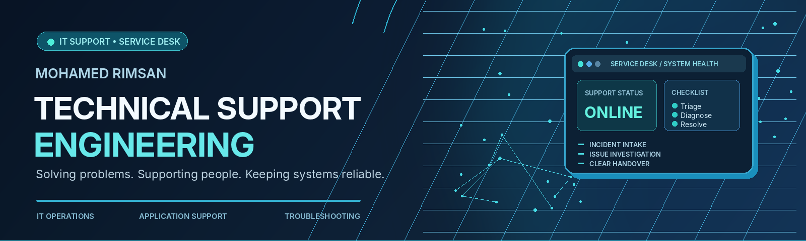
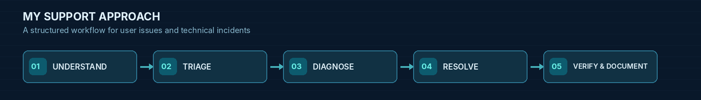

<!--
  MOHAMED RIMSAN — GITHUB PROFILE
  Professional focus: Technical Support Engineering, IT Support, Service Desk,
  Systems & Application Support, IT Operations.
  GitHub profile repository: github.com/mohamedrimsan/mohamedrimsan
  NOTE: Commit this README.md and the assets/ directory together.
-->

 

  

**📍 Sri Lanka &nbsp; • &nbsp; 🎓 BSc (Hons) Information Technology Undergraduate &nbsp; • &nbsp; 🎧 Remote Help Desk Experience**

Focused on growing within enterprise IT support, service desk operations, systems support and infrastructure engineering.

---

[**About**](#-about-me) &nbsp;•&nbsp; [**Experience**](#-professional-experience) &nbsp;•&nbsp; [**Skills**](#-technical-toolkit) &nbsp;•&nbsp; [**Projects**](#-projects--hands-on-training) &nbsp;•&nbsp; [**Learning**](#-professional-development) &nbsp;•&nbsp; [**Connect**](#-lets-connect)

## 👨‍💻 About Me

I'm **Mohamed Rimsan**, an IT professional and **BSc (Hons) Information Technology undergraduate** building my career in **Technical Support Engineering, IT Support, Service Desk Operations, and Systems & Application Support**.

As a **Help Desk Representative at Tech Bridge Solutions Ltd**, I support users remotely with application, operating-system, connectivity, access, hardware and software issues. My responsibilities include gathering issue details, guiding users through troubleshooting, maintaining support records, coordinating escalations and communicating progress.

I previously worked in **QA & Security Engineering at SAĜO Mente International**, where I investigated application defects, tested APIs, analyzed system behavior, supported deployment checks, and worked with engineering teams to verify fixes. This experience adds depth to my technical troubleshooting and application-support approach.

I'm actively strengthening my knowledge of **enterprise networking, Microsoft 365, Active Directory, Windows Server, PowerShell and IT service management** through independent learning and practical exercises. These are **areas of ongoing development**, not claims of professional administration experience.

> **My focus:** Understand the issue, communicate clearly, investigate systematically, and help restore dependable service.

## 🎯 Where I Focus

<table>
<tr>
<td width="33%" valign="top">

### 🎧 IT Support & Service Desk

- Remote end-user support
- Incident and service request handling
- Hardware/software troubleshooting
- Ticket documentation and follow-up
- Escalation and customer communication

</td>
<td width="33%" valign="top">

### 🖥️ Systems & Application Support

- Windows and Linux fundamentals
- Application and API investigation
- Connectivity and access issues
- Log and error analysis
- Deployment and release verification

</td>
<td width="33%" valign="top">

### ⚙️ IT Operations & Growth

- Networking fundamentals
- Structured problem-solving
- Knowledge-base documentation
- Security-aware troubleshooting
- Learning enterprise IT infrastructure

</td>
</tr>
</table>

## 💼 Professional Experience

### 🎧 Help Desk Representative — Tech Bridge Solutions Ltd

**Feb 2025 – Present &nbsp; | &nbsp; Remote &nbsp; | &nbsp; Manchester, United Kingdom**

- Provide remote user assistance with application, operating-system, connectivity, account-access, hardware and software issues.
- Collect relevant information, investigate reported problems and guide users through appropriate troubleshooting steps.
- Document incidents and service requests, manage follow-ups and escalate issues requiring additional support.
- Keep users informed through clear technical guidance, accurate records and coordination with support teams.

**Experience areas:** `Remote Support` `Troubleshooting` `Incident Handling` `Escalation` `Customer Communication` `Support Documentation`

<b>🔎 Earlier engineering experience — QA, application diagnostics & security validation</b>

 

### QA & Security Engineer Trainee — SAĜO Mente International Sdn Bhd

**Jul 2026 – Sep 2026 &nbsp; | &nbsp; Moratuwa, Sri Lanka**

- Investigated web and mobile application issues across user, provider, organization and administrator workflows.
- Validated REST APIs, authentication, authorization, input handling and response behavior with Postman and Swagger/OpenAPI.
- Tracked and retested defects with Jira; verified fixes, access controls and application behavior.
- Supported AWS/VPS deployment checks using logs, configurations and API responses.
- Performed automation, performance and security testing with Playwright, Selenium, k6, JMeter, Burp Suite and OWASP ZAP.

### QA & Security Engineer Intern — SAĜO Mente International Sdn Bhd

**Mar 2026 – Jun 2026 &nbsp; | &nbsp; Moratuwa, Sri Lanka**

- Conducted functional, regression, exploratory and responsive testing of web and mobile applications.
- Reproduced application defects, recorded findings in Jira and verified corrective changes.
- Collaborated with development and QA teams in Agile stand-ups, UAT and release reviews.

**Transferable strengths:** `Application Troubleshooting` `API Diagnostics` `Defect Investigation` `Log Analysis` `Documentation` `Technical Collaboration`

---

## 🧰 Technical Toolkit

### 🖥️ End-User Support & Operating Systems

`Remote Troubleshooting` · `Operating System Issues` · `Application Support` · `Connectivity Problems` · `User Guidance` · `Incident Documentation` · `Issue Escalation` · `Hardware & Software Troubleshooting`

### 🛠️ Application Diagnostics, Tickets & Engineering Tools

`Application Issue Reproduction` · `REST API Validation` · `HTTP Responses` · `Defect Tracking` · `Root Cause Investigation` · `Log Analysis` · `Deployment Checks` · `Technical Reporting`

### ☁️ Cloud, Infrastructure & Development Exposure

`AWS ECS / ECR / CloudShell Exposure` · `Docker` · `Linux Environments` · `CI/CD` · `Database Troubleshooting` · `SMTP Workflows` · `Version Control`

<b>🔐 View my earlier QA, automation & cybersecurity toolkit</b>

 

**Previous areas of practice:** Functional, regression, exploratory and API testing · Test automation · Performance testing · Application security · Authentication and access-control validation · Vulnerability assessment · Defect remediation verification · Release-readiness checks.

---

## 🚀 Projects & Hands-On Training

<table>
<tr>
<td width="50%" valign="top">

### 🎧 ServiceDesk Simulator

**IT Support & Service Desk Training — Ongoing**

Practicing the concepts and workflows used in a service desk environment, with a focus on structured troubleshooting, incident handling, user communication and documenting support cases.

**Learning focus:** Ticket triage · Windows/user issues · Escalation · Support documentation

</td>
<td width="50%" valign="top">

### 🛡️ AssureX

**Quality, Security & Risk Assurance Platform**

Designed and developed a full-stack platform for test management, vulnerability and asset tracking, remediation workflows, CVSS v3.1 risk scoring, role-based access, MFA, audit logs and reporting.

**Stack:** Next.js · TypeScript · PostgreSQL · Prisma · Playwright · Docker

</td>
</tr>
<tr>
<td width="50%" valign="top">

### 🧪 VeriGuard

**QA Automation & Testing Platform — Active Development**

Developing a testing platform with project/environment management, REST API workflows, secure credential handling, background job processing, task lifecycle tracking and health monitoring.

**Stack:** Next.js · NestJS · TypeScript · PostgreSQL · Redis · BullMQ · Docker · Jest

</td>
<td width="50%" valign="top">

### 📧 MailForge

**Email Campaign & Tracking Platform — Active Development**

Developed campaign, contact, SMTP, template, attachment, scheduling and tracking features. Worked on email delivery and database-migration troubleshooting across frontend, backend and worker services.

**Stack:** Next.js · Node.js · TypeScript · PostgreSQL · Prisma · Redis

</td>
</tr>
</table>

<b>📂 Explore additional technical detail from my projects</b>

 

**AssureX:** Test case execution, vulnerability management, asset management, remediation tracking, CVSS scoring, audit logging, risk dashboards, PDF reporting and role-based access controls.

**VeriGuard:** Organization/project/environment management, API integrations, Redis/BullMQ background processing, AES-256-GCM credential protection, test execution workflows and readiness/health checks.

**MailForge:** SMTP integration, scheduled campaigns, templates, recipient management, attachments, delivery tracking, reporting and troubleshooting of service interactions.

**Previous security labs:** LetsDefend SOC exercises and cybersecurity simulations covering alert triage, log investigation, phishing analysis, threat identification and incident-response processes. These are learning experiences, not professional SOC employment.

---

## 📚 Professional Development

<table>
<tr>
<td width="52%" valign="top">

### 🎯 Current Learning Priorities

- **Enterprise support:** Windows support, Microsoft 365, Active Directory, Windows Server
- **Networking:** TCP/IP, DNS, DHCP, connectivity troubleshooting
- **Service delivery:** ITSM, incident workflows, prioritization, escalation and documentation
- **Automation & systems:** PowerShell, endpoint concepts and basic systems administration

These are ongoing learning goals; not claimed workplace administration experience.

</td>
<td width="48%" valign="top">

### 🎓 Education

**BSc (Hons) Information Technology**  
The Open University of Sri Lanka

**2023 – 2027 (expected)**  
**CGPA: 3.46** (last reported)

Focus areas include computing, programming, databases, networking and information systems.

</td>
</tr>
</table>

### 🏅 Selected Certifications & Training

| Credential | Issuer | Status / date |
| :--- | :--- | :--- |
| Google Cybersecurity Professional Certificate | Google / Coursera | Jan 2026 |
| Junior Cybersecurity Analyst Career Path | Cisco Networking Academy | Jul 2025 |
| Introduction to Cybersecurity | Cisco Networking Academy | Completed |
| ISO/IEC 27701:2025 Lead Auditor Training | Training programme | Completed training |
| Software Testing & Automation Specialization | University of Minnesota / Coursera | In progress |
| ServiceDesk Simulator | Independent practical training | In progress |

> My current career development is focused on IT support, IT operations and infrastructure. Earlier QA and security credentials remain part of my technical foundation.

---

## 📊 GitHub Activity

 

GitHub analytics images are provided by third-party services and may occasionally be unavailable.

---

## 📫 Let's Connect

**Interested in Technical Support Engineering · IT Support · Service Desk · Application Support · Systems Support roles**

 

  

**📧 [mohamed.rimsan.ar@gmail.com](mailto:mohamed.rimsan.ar@gmail.com) &nbsp; | &nbsp; 📞 [+94 77 404 7471](tel:+94774047471)**

---

Technical Support Engineering • IT Operations • Systems & Application Support

**Clear communication. Structured troubleshooting. Reliable solutions.**

